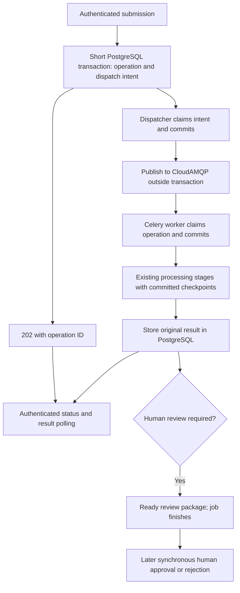

# Background processing with Celery and CloudAMQP

Status: application integration and review fixes implemented; migration,
dependency installation, and live acceptance/recovery verification remain pending.

Prepared on 2026-10-16 against the current working tree. Read this together with
`docs/short_transactions_plan.md` and `docs/authentication.md`. Some older
verification notes in those documents describe earlier database revisions;
inspect the current schema before implementation rather than relying on them.

Review amendments: queue deadlines now have explicit generation semantics;
incremental audit persistence preserves later decision links; failures before
worker ownership have a guarded recording path; worker-pool selection requires
a long-task broker test; and the manual polling command takes an argument.

## 1. Outcome and scope

An agent submits an evaluation and quickly receives a durable operation ID.
Celery performs slow processing in a separate process. The agent reads progress
and fetches the original completed response through authenticated endpoints.
Human review remains a separate state: no HTTP request or worker waits for a
human to respond.



Use these components:

| Component | Responsibility |
| --- | --- |
| FastAPI | Authentication, validation, submission, status and result retrieval, short control mutations |
| PostgreSQL | Authoritative operation state, frozen input, checkpoints, dispatch records, decisions and audit |
| CloudAMQP AMQP broker | Deliver operation references to Celery workers |
| Celery worker | Run existing staged workflows and resume committed checkpoints |
| Dispatcher/recovery process | Publish committed dispatch records and recover abandoned jobs |
| Existing Redis | Continue embedding caching and existing uses |
| Existing Qdrant/model providers | Continue semantic retrieval and model work |

There is no Celery result backend. PostgreSQL already stores encrypted original
responses. Do not create a second result history in Redis, use an RPC result
backend, or poll `AsyncResult` from the public API.

Do not add Kafka, Celery Beat, Flower, Docker, webhooks, SSE, cancellation APIs,
per-provider task queues, or one Celery task per LLM stage in this phase. One
task runs one durable operation; existing checkpoints delimit its internal
stages. These choices keep the first implementation reviewable.

### 1.1 Verified preflight

`reports/background_queue_preflight_20261016.json` records the completed probe:

- `.env` contains `CLOUDAMQP_URL` with the `amqps` scheme.
- TLS certificate and hostname verification, authentication and virtual-host
  access succeeded.
- The server identifies itself as **LavinMQ 2.10.2**, rather than RabbitMQ.
- Creating an exclusive temporary queue, publishing with confirmation,
  consuming the matching JSON message, acknowledging it and deleting the queue
  succeeded.
- Celery 5.6.3, Kombu 5.6.2 and amqp 5.4.1 installed in an isolated temporary
  environment. `pip check` passed there.
- No application Celery task or worker was tested. Durable application queue
  declarations, recovery and the full project dependency set still need tests.

The final probe used one harmless message. No existing queue was purged. No
project dependency, `.env` value, database model or database schema was changed.

**Python compatibility gate:** the current interpreter is Python 3.14.7.
Celery 5.6's published support list and 5.6.3 PyPI classifiers list Python
through 3.13. Installation and an AMQP round trip on 3.14 are useful evidence,
but do not establish supported worker behavior. First run the worker smoke
checks on the existing interpreter. Record the result. Before declaring a
supported deployment, verify an updated support statement or use a separately
validated supported interpreter. Do not silently change the project's Python
version or regenerate all its dependency pins.

### 1.2 Correct the earlier proposal about approval

Current `escalation_service.decide()` and `_finish_approval()` are database-only.
They use frozen evidence, deterministic policy checks and token issuance; they
do not call a review-note LLM. Keep approval and rejection synchronous. Moving
them to Celery would add complexity without removing current cloud latency.

## 2. Repository map and integration boundaries

Inspect these files before coding:

| File | Existing behavior to preserve |
| --- | --- |
| `src/main.py` | Routes, permission middleware, HTTP error mapping and request monitoring |
| `src/services/workflow.py` | Operation identity, leases, fenced transactions, encrypted responses, resume behavior |
| `src/models/workflow.py` | SQLModel and Pydantic workflow contracts |
| `src/services/workflow_flows.py` | Detached cloud phases and database finalization for evaluate/interpret/prepare/rollback |
| `src/services/authentication.py` | Verified caller context, authorization refresh and object ownership |
| `src/services/monitoring.py` | Detailed provider/parser events, correction messages and persistence |
| `src/services/agent_review.py` | Owner-only access to the original approved capability |
| `src/services/escalation_service.py` | PREPARING/PENDING gates and atomic human decisions |
| `src/db/database.py`, `transaction_guard.py` | Engine lifetime and no-open-transaction guard |
| `src/services/llm_routing.py`, `config/llm_routing.yaml` | Existing stage/provider correction and retry budgets |

Proposed additions:

```text
src/models/workflow_dispatch.py        # dispatch table and write contracts
src/services/workflow_submission.py   # durable submit/idempotent lookup
src/services/workflow_runner.py       # validated kind -> existing flow dispatch
src/services/workflow_dispatch.py     # outbox claim/publish/recovery logic
src/workers/__init__.py
src/workers/celery_app.py              # broker/task configuration only
src/workers/tasks.py                   # thin task wrapper and worker lifecycle
src/workers/dispatcher.py              # standalone dispatcher/recovery CLI
scripts/background_queue_preflight.py # reusable harmless AMQP probe
scripts/background_live_e2e.py         # live queue/state/recovery checks
docs/background_processing.md         # operator/client guide after implementation
```

Extract `parse_for_evaluation()` from inside `create_app()` to a shared service
module (for example `src/services/parser_entrypoint.py`). Preserve its parser and
analyzer monitoring. Workers must not import `src.main`, create an ASGI app, or
depend on a request-local closure. Keep `workflow.run()` for synchronous flows
and direct CLI compatibility; share its identity/response helpers rather than
maintaining two conflicting idempotency implementations.

## 3. Which endpoints change

| Endpoint | Background mode behavior |
| --- | --- |
| `POST /api/v1/actions/evaluate` | Submit `evaluate`; normally return 202 |
| `POST /api/v1/actions/evaluate-prompt` | Submit `interpret`; normally return 202 |
| `POST /api/v1/actions/clarifications/{interpretation_id}` | Reserve turn and submit `clarify`; normally return 202 |
| `POST /api/v1/escalations/{decision_id}/prepare` | Submit `prepare_review`; normally return 202 |
| `POST /api/v1/actions/rollback/{execution_id}` | Submit `rollback`; normally return 202 |
| `POST /api/v1/control/approve/{decision_id}` | Keep synchronous, including atomic approval/rejection and authorization finalization |
| Policy/agent promotion | Keep synchronous |
| `POST /api/v1/actions/execute` | Keep current synchronous, transactional simulated execution |
| Auth/read/replay routes | Keep synchronous |

Confirm literal route paths against `src/main.py` before editing. The execution
adapter currently changes simulated PostgreSQL resources in the same
transaction as token consumption. Real filesystem/network side effects need a
separate execution-recovery design; do not introduce them here.

Evaluation still prepares its escalation package before completing the
operation. A held decision can exist while the package is PREPARING. A client
may see that preparation status, but approval/rejection is allowed only after
the package reaches PENDING with its fingerprint and complete explanations.

## 4. Invariants the implementation must preserve

1. No transaction stays open during provider, Redis, Qdrant, broker, socket,
   sleep, join or publish-confirm waits. Call `assert_no_transaction()` at
   broker/provider boundaries. The dispatcher and lease heartbeat use their
   own short transactions.
2. Accepting a job and recording its dispatch intent commit atomically. The API
   never relies on a successful `.delay()` after committing a separate row.
3. Queue delivery is at least once. A repeated Celery task ID is not a lock and
   does not provide deduplication. PostgreSQL operation ownership does.
4. Only the current owner/generation may commit progress or final effects.
5. Duplicate input with the same scoped key reuses one operation. Different
   input with that key returns 409 without changing it.
6. Retry uses the first normalized input, request ID, timestamp and committed
   checkpoints. A fresh Pydantic default must not silently change the action.
7. Existing grounding, parser errors, corrective messages, semantic evidence,
   replay behavior, human records and permission checks remain intact.
8. A queue/worker failure never becomes an ALLOWED decision or a completed
   human approval. Missing analysis follows existing incomplete-analysis rules.
9. Completing an evaluation that requests clarification or human review ends
   the job. A later human/agent response starts a separate operation.
10. Authentication/authorization are checked at acceptance and again before
    worker state changes. No raw API key or JWT is put in a queue or job row.

## 5. Database and contract changes

Implement models and matching Pydantic write/read validators together. Use
shared enums and named SQL constraints. Do not relax current decision contracts
to make job states fit into `decisions`.

### 5.1 Extend `workflow_operations`

Reuse this table rather than introducing another job table.

| Field/change | Purpose |
| --- | --- |
| `execution_mode`: `synchronous`/`background`, default synchronous | Distinguish existing rows and prevent accidental background recovery of legacy jobs |
| Add `QUEUED` and `RETRY_WAIT` to `WorkflowStatus` | Separate waiting from an actively leased PROCESSING job |
| `owner`, `lease_until` nullable | Queued jobs have no worker owner/lease |
| `input_envelope`: nullable encrypted JSON wrapper | Frozen job inputs and verified authorization context; required for new background rows |
| `generation`: nonnegative integer, default 0 | Fence stale dispatches/retries; first background run uses generation 1 |
| `run_count`: nonnegative integer, default 0 | Count successful worker claims, not duplicate deliveries |
| `automatic_retry_count`: nonnegative integer, default 0 | Bound automatic whole-job recovery separately from LLM retries |
| `next_run_at`: nullable UTC timestamp | Durable infrastructure backoff for RETRY_WAIT |
| `queue_deadline`: nullable UTC timestamp | Latest permitted claim time for the current QUEUED generation |
| `run_deadline`: nullable UTC timestamp | Bound one worker run, including heartbeat extension |
| `heartbeat_at`: nullable UTC timestamp | Last successful operation-lease refresh |

Keep current checkpoint, encrypted response, full error, caller ownership,
scope/key/hash and timestamps. Add indexes for queued/retry due time and
background PROCESSING lease expiry and QUEUED queue_deadline. Use UTC comparisons
consistently with the existing naive-datetime compatibility helper; do not accidentally rewrite all
existing timestamps in this phase.

State contracts:

- QUEUED: background envelope present, owner/lease absent, no response/error,
  `retryable=false`, no `next_run_at`, queue_deadline required.
- PROCESSING: owner and lease required, no response/error, `retryable=false`;
  background claims also require a run deadline and generation >= 1. Clear
  queue_deadline when the claim commits.
- RETRY_WAIT: background envelope present, owner/lease absent, no response,
  error present, `retryable=true`, `next_run_at` required, queue_deadline absent.
- COMPLETED: encrypted response present, no error, `retryable=false`; clear
  active scheduling fields. Accept legacy terminal owner/lease pairs during
  migration, while new background writes clear them.
- FAILED: full error present, no final response, no active lease/schedule for
  new background rows. `retryable` means an explicitly authenticated resubmit
  may resume; it does not mean the dispatcher retries forever.

A completed parser DENIED response is a **COMPLETED operation** with a saved
HTTP 400 business response. It is not an infrastructure FAILED job. Likewise,
an ESCALATED result completes evaluation; it is not RETRY_WAIT.

### 5.2 Frozen encrypted input envelope

Define a versioned Pydantic contract before encryption:

```json
{
  "version": "background-input-v1",
  "kind": "interpret",
  "resource_scope": "original un-hashed business scope",
  "request": {"request_id": "...", "agent_id": "...", "actor_role": "workspace_agent", "raw_prompt": "..."},
  "arguments": {},
  "authorization": {
    "principal_id": "...",
    "credential_id": "...",
    "auth_version": 1,
    "expires_at": "...",
    "correlation_id": "...",
    "route": "/api/v1/actions/evaluate-prompt"
  },
  "accepted_at": "..."
}
```

`arguments` is typed per kind: clarification interpretation ID and submitted
answer, preparation decision ID, or rollback execution ID. Store the normalized
request as well as the original submitted-field digest basis if needed to
preserve `exclude_unset` identity semantics. Validate kind/arguments/request
consistency before every new run. Do not serialize `_semantic_analysis` using
ordinary `model_dump()` and assume private attributes survive; the existing
parsed checkpoint explicitly carries analysis separately and must keep doing so.

Use a new encryption-purpose prefix, such as `workflow-input-v1:`, with the
existing SECRET_KEY/Fernet mechanism. Preserve the existing response cipher
format so old responses remain readable. This encryption does not remove the
user-requested prompt/response/error history from existing audit records.

Never accept the authorization envelope from an HTTP payload or trust queue
arguments to supply identity/permissions.

### 5.3 New `workflow_dispatches` table: transactional outbox

This is the new table proposed by this plan. It stores delivery intent, not
model output, another decision or another copy of the prompt.

| Field | Meaning |
| --- | --- |
| `dispatch_id` UUID primary key | Stable dispatch reference; also Celery task ID |
| `operation_id` FK | Job being delivered |
| `generation` integer >= 1 | Intended run generation |
| `queue_name` | Validated configured application queue |
| `status`: PENDING/PUBLISHING/PUBLISHED/CANCELLED | Dispatch lifecycle |
| `publisher_owner`, `publisher_lease_until` nullable | Claim for publication outside a DB transaction |
| `publish_attempts` integer >= 0 | Transport attempts; separate from worker runs |
| `available_at` | Earliest publication time |
| `published_at`, `last_error` nullable | Publication evidence/diagnostic detail |
| `created_at`, `updated_at` | Audit timestamps |

Constraints: unique `(operation_id, generation)`, FK to operations, named state
checks, owner/lease pair present only for PUBLISHING, nonnegative counts, and
index `(status, available_at)`. PUBLISHED requires `published_at`. Retain a
previous publication timestamp when a confirmed delivery is scheduled for a
bounded re-publication; do not pretend it was never published.

Use a Pydantic `WorkflowDispatchWrite` and versioned task argument contract.
Lock order for operations involving both records is **operation first,
dispatch second**. Scanner selection can read candidate IDs without locks;
claim each operation with `FOR UPDATE SKIP LOCKED`, then its dispatch. Never
hold a dispatch lock while waiting to lock its operation.

### 5.4 Existing business/audit tables

- `decision_records`: unchanged responsibility and output structure.
- `request_interpretations`: reserve PROCESSING turns before enqueue; preserve
  revision checks and complete/failed turn history.
- `escalation_queue`: keep PREPARING/PENDING/APPROVED/REJECTED gates.
- `human_review_records`: keep existing atomic human audit and authorization
  links; no new review-note judgment model in this phase.
- `request_attempt_events`: add nullable indexed `operation_id` FK. Add a named
  unique `(attempt_id, sequence)` constraint for incremental event persistence;
  check existing data for duplicates first. Existing null operation IDs remain
  valid. Continue recording full parser messages, responses, validation JSON,
  prose feedback, provider details and exception history.
- `auth_events`: reuse for submission, worker-stage authorization and result
  access audit; no new auth table.

### 5.5 Migration boundary

The coding handoff updates models and `alembic/env.py` imports, then stops at a
schema review checkpoint. **Do not generate or apply migrations automatically
as part of this plan's implementation permission.** The user previously asked
to control migration generation; obtain that instruction at the checkpoint.

Commands for that later authorized step:

```bash
alembic current
alembic revision --autogenerate -m "Add background workflow dispatch"
```

Review manually: status CHECK changes (autogenerate may miss them), nullable
owner/lease, sensible defaults/backfill for legacy operations, JSON SQL NULL
handling, dispatch FKs/indexes/checks, monitoring uniqueness and downgrade order.
Reject unrelated schema changes. Then, when authorized:

```bash
alembic upgrade head
alembic check
```

Never use `create_all()`, start SQLite, or delete existing workflow rows to make
the migration pass. Historical synchronous rows lack envelopes; do not enqueue
them. They remain readable and resumable through the existing synchronous path.

## 6. Configuration, installation and Celery choices

### 6.1 Dependency installation

Add `celery==5.6.3` to the existing `requirements.txt`; do not create a separate
providers/workers requirements file. Celery includes its AMQP transport
dependencies. Neither `celery[redis]` nor `pika` is needed for integration.

From the active project environment:

```bash
python --version
python -m pip install --dry-run -r requirements.txt
python -m pip install -r requirements.txt
python -m pip check
python -m celery --version
```

Record resolver conflicts and fix the narrow conflicting pins; do not overwrite
the requirements file with a global `pip freeze`. Record resolved Kombu/amqp/
billiard versions. Temp-environment installation succeeded, but the full project
resolver has not yet been tested with Celery.

### 6.2 Add settings to `src/config.py`

Defaults below are proposed initial operating values, not measured capacity:

| Setting | Default | Validation/use |
| --- | --- | --- |
| `BACKGROUND_WORKFLOWS_ENABLED` | false | Explicit rollout switch; false preserves current endpoints |
| `CLOUDAMQP_URL` | empty secret value | Required for worker/dispatcher/background mode; require amqps |
| `WORKFLOW_QUEUE_NAME` | guarded-autonomy-layer.workflows.v1 | Project-specific durable queue, distinct in isolated tests |
| `WORKFLOW_DISPATCH_POLL_SECONDS` | 2 | Positive; sleep outside transaction |
| `WORKFLOW_DISPATCH_BATCH_SIZE` | 10 | Bounded; claim/publish one row at a time initially |
| `WORKFLOW_HEARTBEAT_SECONDS` | 30 | Must be well below lease length |
| Existing `WORKFLOW_LEASE_SECONDS` | 900 | Shared lease setting; do not add a competing worker lease setting |
| `WORKFLOW_MAX_RUN_SECONDS` | 600 | Absolute run deadline; lease renewals cannot extend past it |
| `WORKFLOW_MAX_AUTOMATIC_RETRIES` | 2 | Initial run plus at most two infrastructure recovery runs |
| `WORKFLOW_RETRY_BASE_SECONDS` | 10 | Exponential infrastructure backoff |
| `WORKFLOW_RETRY_MAX_SECONDS` | 300 | Backoff cap |
| `WORKFLOW_REDELIVERY_CHECK_SECONDS` | 300 | Revisit PUBLISHED but unclaimed jobs; bounded same-generation republish |
| `WORKFLOW_QUEUE_TIMEOUT_SECONDS` | 86400 | Fail visibly if a job cannot start within this waiting budget |
| `CLOUDAMQP_CONNECTION_TIMEOUT_SECONDS` | 10 | Bound connection establishment |
| `CLOUDAMQP_PUBLISH_TIMEOUT_SECONDS` | 10 | Bound write/confirm wait |

Store CLOUDAMQP_URL as a secret-aware setting and unwrap only when constructing
the connection. Do not print all settings. Derive producer retry delays from the
same bounded backoff helper; avoid a second transport retry ladder hidden in
Celery. Queue names must not contain credentials or caller identifiers.

Keep LLM provider routing, embedding model selection, semantic mode and cache
configuration unchanged. Startup records a non-secret configuration digest so
reports can distinguish worker versions/configuration. Require API and workers
to use the same schema and intended configuration during this rollout.

`WORKFLOW_QUEUE_TIMEOUT_SECONDS` applies to each generation's queue wait, not
the operation's original created_at or encrypted envelope accepted_at. Define
queue_deadline as follows:

- First acceptance or authorized FAILED resubmission: set to the time of the
  QUEUED transition plus the configured timeout.
- Automatic recovery: clear the old deadline when scheduling RETRY_WAIT; set
  a new deadline when that generation actually transitions to QUEUED. Backoff
  time is not counted as that generation's queue wait.
- Duplicate POST, duplicate delivery, publication retry or same-generation
  republish: preserve the deadline exactly; these never extend queue time.
- Successful claim or transition to FAILED/COMPLETED: clear the queue deadline.

The dispatcher checks the deadline under lock before publication/recovery, and
the worker checks it before claim. On expiry, use the shared queued-failure
transition. Preserve original operation creation time and prior timeout events
as history. An explicit retry of a previously timed-out job gets a fresh queue
budget without changing its frozen action or erasing prior failures.

### 6.3 Celery configuration

In `src/workers/celery_app.py`, construct `celery_app` without connecting during
import. Declare one named durable direct exchange/queue and explicit task route.
Use standard AMQP queue declarations accepted by the current LavinMQ instance;
do not require quorum queues, RabbitMQ plugins, delayed-message exchanges,
RabbitMQ-only consumer arguments or broker-specific delivery limits.

```python
task_serializer = "json"
accept_content = ["json"]
result_serializer = "json"
result_backend = None
task_ignore_result = True
task_store_errors_even_if_ignored = False
task_track_started = False
task_always_eager = False
task_acks_late = True
task_reject_on_worker_lost = True
task_acks_on_failure_or_timeout = True
task_default_delivery_mode = "persistent"
task_create_missing_queues = False
task_publish_retry = False
worker_prefetch_multiplier = 1
worker_send_task_events = False
task_send_sent_event = False
worker_enable_remote_control = False
broker_pool_limit = 1
broker_transport_options = {"confirm_publish": True}
broker_heartbeat = 30
broker_connection_retry_on_startup = True
timezone = "UTC"
enable_utc = True
```

Add bounded broker connection/publish timeouts. Configure TLS with
`ssl.CERT_REQUIRED` **and explicit `server_hostname` derived from the parsed
broker URL**; the preflight tested both. Never downgrade TLS after failure.

AMQP transport heartbeats are different from Celery worker event heartbeats
and PostgreSQL operation-lease heartbeats. Keep AMQP heartbeat initially at 30
and turn off Celery event/gossip chatter in the worker command. CloudAMQP's
older Celery guide recommends disabling AMQP heartbeats, but that is not
required by this probe. If deployment networking needs a different setting,
validate it explicitly rather than conflating these three mechanisms.

Worker-pool selection is a validation checkpoint, not a tested property of the
existing connection probe. Solo executes tasks inline and can block the
consumer loop that services AMQP heartbeats. Before selecting it, run the
long-task broker test in section 14.1. A `threads` pool with concurrency 1 is
the alternative to validate if solo loses its connection during a long task.
Neither pool should be described as having prefork hard task termination.
Do not disable broker heartbeats merely to make a smoke test pass. Record the
negotiated interval, pool and observed connection/acknowledgment behavior.

No broad `autoretry_for=(Exception,)`, no `self.retry()` infrastructure loop,
no Celery countdown/ETA retries in this phase. PostgreSQL dispatch scheduling
owns whole-job retries. Existing LLM correction/provider retries stay where
they are. A worker records expected failures and returns normally so the
message is acknowledged; a process crash may cause broker redelivery.

## 7. Submission sequence: implement precisely

Create a `submit()` service independent of FastAPI response objects where
practical. Input: verified Caller, kind, original business scope, effective
key, original submitted payload, normalized typed envelope arguments.

1. Validate the key and calculate operation identity using the current
   principal-scoped digest algorithm. Preserve request-ID/header defaults.
2. Start a short transaction. Lock an existing operation if present, then
   authorize from the verified caller. Keep the existing operation-before-
   principal/credential lock order used by `workflow.run()` and
   `Operation.transaction()`; administrative auth changes lock principal then
   credential, as they already do. Do not introduce the opposite order in a
   new submission/worker path.
3. Insert a new row if needed under the current unique identity constraint.
   Handle simultaneous first inserts with a bounded conflict/re-read path, not
   unbounded recursion. Authorization must pass before committing acceptance.
4. Existing operation with different input hash: 409. Do not reset its job.
5. Existing COMPLETED operation: return the stored original response through
   the existing route-specific projection; never mint another capability.
6. Existing QUEUED, PROCESSING or RETRY_WAIT: return 202 progress. Do not extend
   leases, create a new generation or spend another retry.
7. Existing retryable FAILED: on an authenticated matching resubmit, refresh
   the envelope authorization context, preserve frozen request/checkpoints,
   start a new generation and enqueue. Reset the per-resubmission automatic
   recovery allowance, while retaining cumulative run_count and prior audit.
   Nonretryable FAILED returns its original public error. Set a fresh queue
   deadline on this transition; preserve all original request timestamps.
8. For a new clarification, call/refactor the existing `_reserve()` logic in
   this transaction: validate ownership, revision and NEEDS_CLARIFICATION/
   permitted failure state; reserve the processing turn and checkpoint source.
   Two different keys must not reserve the same revision. For a new NL request,
   reserve its interpretation now as well. The worker must recognize and reuse
   this reservation rather than making another interpretation/turn.
9. Store encrypted frozen input, status QUEUED, generation 1, and one PENDING
   dispatch for that generation. Set queue_deadline and store the stable
   correlation ID for audit.
10. Commit everything, then construct the 202 response. No broker connection,
    provider work or publish-confirm wait occurs in the API request.

If PostgreSQL is unavailable before commit, return 503 and do not claim the job
was accepted. If the HTTP response is lost after commit, the client's matching
retry discovers the committed job.

If background mode is disabled, preserve synchronous operation behavior.
Dispatch based on each row's execution_mode; switching the API flag must not
cause a queued background job to run inline or prevent its worker from draining.

### 7.1 Keep interpretation reservations recoverable

New queue waits introduce a failure before parsing has even started. Add a
shared database-only failure projection helper rather than relying on current
`Operation.fail()`, which closes processing interpretations only for some
nonretryable failures.

- While the operation is QUEUED/PROCESSING/RETRY_WAIT, its reserved turn remains
  PROCESSING and rejects a competing clarification.
- When a job becomes FAILED for queue timeout, auth failure or exhausted
  recovery, change a still-matching reserved PROCESSING turn to PROCESSING_FAILED
  in the same transaction, with error_type/message. Match interpretation ID,
  revision and request ID before changing it. Do not overwrite an EVALUATED,
  REJECTED, PROVIDER_FAILED or newer turn.
- Explicit authenticated same-key resume must check that no newer clarification
  superseded the reserved revision. If a matching failed turn needs another
  processing reservation, append the next revision using the existing history
  rules; retain the old failed turn and original instruction. Reuse valid frozen
  parsed/evidence checkpoints rather than clearing them unconditionally.
- Parser-provider exhaustion already records a PROVIDER_FAILED turn and uses
  `provider_retry_pending`; preserve its behavior and deliberately discard only
  that failed parser checkpoint when a caller explicitly retries it.
- If a newer clarification won the race, return a recorded stale-state conflict
  for the old operation. Do not reopen the older revision.

Test these transitions with validators as well as row counts. Otherwise a failed
queued job could leave the request permanently stuck in processing, or a retry
could erase failure history and repeat a completed policy decision.

## 8. Dispatcher and recovery sequence

Run one standalone process initially. Multiple instances must nevertheless
cooperate correctly using PostgreSQL row claims.

### 8.1 Publish

1. Select a small set of due candidate IDs, without holding locks during any
   remote work. For each, lock operation first and dispatch second.
2. Check execution_mode, matching generation and QUEUED state. Cancel obsolete
   intents. Claim due PENDING or expired PUBLISHING rows with a random publisher
   token and a short lease (at least twice the publish timeout).
3. Increment publish_attempts and commit the PUBLISHING claim.
4. Outside every transaction, declare/bind the configured durable application
   queue and publish the registered Celery task with publisher confirmation,
   persistent delivery and mandatory routing/returned-message handling.
5. Arguments contain only `operation_id`, `dispatch_id`, `generation` and a
   protocol version. Set task ID to dispatch_id and `argsrepr`/`kwargsrepr` to
   the same harmless references. Never pass raw prompts, JWTs or model keys.
6. Start a new short transaction. Update the dispatch only if its publisher
   token still matches. A confirmed publish becomes PUBLISHED; transport or
   unroutable errors become PENDING with bounded backoff and full diagnostic
   details. If the worker already claimed/completed the job, reconcile the
   dispatch without rewriting operation state.
7. Sleep outside transactions between scans. Reuse a bounded producer
   connection rather than reconnecting for every idle poll.

A broker confirmation means the broker accepted publication; it does not mean
the worker completed it. Mandatory routing/queue declaration handles the
different problem of publishing to no destination. Check Kombu's returned-
message behavior in the preflight and add a regression case for unroutable jobs.

### 8.2 Recover and reconcile

Run recovery in the dispatcher loop, not Celery Beat:

- Expired PUBLISHING claim: make it publishable again. Publication might have
  succeeded before the publisher crashed, so duplicate delivery is expected.
- PUBLISHED dispatch with still-QUEUED job after the redelivery check interval:
  allow bounded, backoff-spaced re-publication of the **same dispatch/generation**.
  This covers lost/non-durable broker data without creating new worker runs.
  Do not republish every two-second poll. Enforce at most one such publication
  per configured interval and keep publish_attempts visible.
- A QUEUED operation at or past queue_deadline: cancel dispatch and mark FAILED
  with an explicit retryable queue-timeout failure. Use its current-generation
  deadline, never created_at/updated_at as a substitute. Do not silently drop it.
- Due RETRY_WAIT: atomically transition to QUEUED and make the existing next-
  generation dispatch PENDING. Clear the active error/next_run_at, set
  retryable=false and initialize queue_deadline in the same transaction. Keep
  the preceding error in audit history and exactly one intent per generation.
- Expired PROCESSING lease/run deadline: under the operation lock, invalidate
  owner, record an abandoned-run event, and schedule a bounded recovery or
  terminal FAILED. A dead worker cannot later commit through the old owner.
- An already COMPLETED/FAILED operation or superseded generation: cancel stale
  pending publications; acknowledge stale messages without cloud calls.

Broker outages should leave accepted jobs visibly QUEUED with dispatch errors.
Do not mark a semantic action safe because the queue is unavailable. Running
jobs may finish during a broker outage if PostgreSQL and providers remain up.

## 9. Worker claim, authorization and execution

### 9.1 Claim and duplicate handling

Register one task, for example `guarded_autonomy.run_operation`.

1. Validate the message shape/version. Invalid messages never execute arbitrary
   code or select an arbitrary service from a supplied module name.
2. Load operation/dispatch in a short transaction, using operation-first lock
   order. Check the dispatch belongs to that operation/generation. PUBLISHING
   is acceptable: consumption can race the publisher's post-confirm DB update.
3. COMPLETED, terminal FAILED, stale generation, active PROCESSING lease, or
   not-yet-due RETRY_WAIT: record a duplicate/stale event and acknowledge without
   work. Recovery will handle an abandoned owner after its lease expires.
4. Only a current QUEUED operation before queue_deadline can be claimed.
   Validate/decrypt its envelope, authorize the initiating principal, assign a
   random owner token, increment run_count, clear queue_deadline, set PROCESSING,
   heartbeat and run deadline, and commit. If validation/auth fails before
   ownership, use section 9.1.1 rather than calling `Operation.fail()` on an
   unclaimed job.
5. Reconstruct typed input and call an allowlisted kind-to-flow dispatch. No
   ORM instance/session, closure, request object or unverified identity crosses
   the slow boundary.

If PostgreSQL is unavailable before a claim, emit a reference-only error and
allow the delivery to finish without a tight broker requeue loop. The dispatcher
will revisit the still-QUEUED published operation after its recovery interval.
After a claim, a failure to record an outcome leaves its lease recoverable.
Never treat a task wrapper's normal return as proof of business completion;
only PostgreSQL status is authoritative. Unexpected wrapper exceptions must
produce diagnostics, and published-but-unclaimed/expired claims must be covered
by the recovery tests.

### 9.1.1 Record failures before ownership

Extend the shared database-only failure helper from section 7.1 to support a
QUEUED operation. An owner-only PROCESSING failure method is insufficient for
expiry, envelope validation or authorization failure before a worker claim.

1. If authorization raises inside the proposed claim transaction, roll back
   that transaction first. Do not commit a half-finished claim.
2. Open a new short transaction; lock operation first, then dispatch. Recheck
   operation ID, message generation, dispatch binding and QUEUED state. If a
   different worker has claimed it or a newer generation exists, do nothing.
3. Write the complete failure/cause chain and public error mapping, change to
   FAILED, clear queue_deadline and active scheduling/owner fields, and cancel
   this generation's dispatch. This does not increment run_count or consume an
   automatic retry because no worker run was claimed.
4. In the same transaction close only a matching reserved PROCESSING
   interpretation as described in section 7.1. Use validated persisted
   reservation identifiers; an undecryptable envelope is not a reason to guess
   which interpretation to change.
5. Commit, persist worker/auth failure diagnostics, then let the delivery be
   acknowledged. Recording an authorization denial must not require passing
   that same failed caller authorization again; this narrow internal helper
   records failure only and cannot grant permission or execute an action.

Auth failures and queue timeout remain eligible for explicit authorized
resubmission, with no automatic retry. Corrupt/unsupported envelopes are
nonretryable pending diagnosis; retain their encrypted input and failure
details. If PostgreSQL cannot record the failure, leave the job recoverable and
use reference-only fallback diagnostics. Do not falsely report FAILED or spend
an automatic recovery attempt without the corresponding durable state change.

### 9.2 Authorization policy

Preserve current strict credentials semantics for this phase:

- Queue delay does not extend the credential/JWT expiry captured at acceptance.
- Resolve current principal/credential from PostgreSQL; require enabled account,
  matching auth_version, unrevoked/unexpired credential and current permissions.
- Reconstruct a Caller from the trusted encrypted envelope and current database
  identity, then use `auth.authorize_operation()` for the existing per-kind and
  ownership checks before each transactional stage/finalization.
- Never set worker authorization to `None` just to bypass request ContextVars.
- If credentials expire or are revoked, fail the job with the appropriate
  recorded auth error and no automatic retry. A later matching submission with
  valid credentials may resume, subject to unchanged business-state checks.
- Result retrieval authenticates the **current HTTP request**; an expired
  original JWT does not make a completed result accessible without new login.

This is deliberately conservative and follows existing synchronous behavior.
A future durable delegation model that survives original token expiry would
be a separate, explicit authorization change.

### 9.3 Context and monitoring

At task entry establish `auth.current` and `monitoring.begin()` explicitly;
Celery does not inherit HTTP ContextVars across processes. Each run gets a fresh
attempt ID linked to the operation and original correlation ID. Preserve
original route/kind. Use try/finally to stop the heartbeat, persist pending
events, and reset all ContextVars before the next task.

Extend `monitoring.Attempt` with operation_id and an incremental persistence
cursor. Persist events after each committed stage and provider/correction event
boundary, in a separate short transaction. Use unique `(attempt_id, sequence)`
and conflict-safe inserts so a repeated flush never duplicates events. Do not
flush while the main stage transaction remains open. Keep the full existing
error JSON, prose, prior response and accumulated LLM message history.

Incremental writes also need **late decision linking**. Existing
`monitoring.link_decision()` fills earlier in-memory events when a decision is
created. Those events may already be in PostgreSQL after this change. A simple
ON CONFLICT DO NOTHING would leave their decision_id permanently null.

- Track a pending decision link separately from the event persistence cursor.
  After its business transaction commits, update already-persisted events for
  the exact attempt_id/operation_id whose decision_id is null. Newly inserted
  events receive the same committed decision ID.
- Do not link events to a decision from a transaction that rolled back. Defer
  database linking until commit succeeds and verify the committed decision
  belongs to the operation's saved result/interpretation.
- Repeating a flush/link is idempotent. Preserve every existing non-null
  decision_id; if it conflicts with the proposed link, record a diagnostic
  rather than overwriting it. Never replace recorded event payloads.
- Advance the persistence cursor and clear pending link work only after their
  database commit succeeds, so a persistence outage can be retried safely.
- A resumed worker can link its own new attempt to a previously committed
  decision when reusing the result checkpoint, without changing older attempts'
  correctly recorded links.

Hard process death can lose the currently in-memory event or an uncheckpointed
provider response. Say this explicitly; do not promise perfect audit capture
of a process killed between receiving and persisting bytes. The next run still
records abandonment/recovery. Persistence failures produce existing fallback
logs and an audit-persistence diagnostic; do not silently discard details.

### 9.4 Leases, run deadlines and connection pools

Start a lightweight lease heartbeat thread for a claimed operation. It uses an
independent Session per refresh and conditional update on operation ID,
PROCESSING status, owner and generation. It never shares the flow's Session.
Refresh only an unexpired lease, at the configured heartbeat interval, and
never extend beyond run_deadline. Stop it on completion/failure/lost ownership.
Set a local lease-lost event; check it before new provider work as well as
before state writes. A failed heartbeat does not grant additional ownership.

The existing `Operation.transaction()` must check generation/deadline as well
as owner/status/lease. Ordinary stage refreshes must also respect run_deadline.
Do not allow a stale thread to resurrect an expired lease. Use a single UTC
comparison basis and atomic conditional updates.

Provider socket/stage deadlines remain the first bound on slow work. Solo and
threads pools do not provide prefork-style hard task termination; do not claim
Celery time limits solve a hung task in either pool. If a run deadline expires,
recovery fences that run even if its process is still waiting. Its later output cannot commit. A
provider call may therefore repeat after recovery; committed business effects
must not repeat. Stop/restart a permanently stuck worker process operationally.

For future prefork workers, initialize/dispose inherited SQLAlchemy pools and
Redis/provider clients in worker-child lifecycle hooks. Do not inherit live
connections across fork. Bound each process's PostgreSQL pool/overflow to the
cloud database connection budget. Initially run one worker with concurrency 1,
using the pool validated by the long-task test; any heartbeat can add another
concurrent DB connection, so budget for it explicitly. Dispatcher and API pools
also count.

## 10. Retry policy: three separate budgets

| Type | Owner | Behavior |
| --- | --- | --- |
| Invalid model output/grounding | Existing parser/analyzer/judge workflow | Corrective feedback and configured output-attempt budget |
| Provider timeout/429/connection error within a stage | Existing routing/provider layer | Existing per-output-attempt provider retries/fallbacks |
| Worker crash/transient DB failure/abandoned operation | New durable workflow scheduler | Resume checkpoints; initial run plus max two automatic recovery runs |

Dispatch publication attempts are a fourth **transport counter**, not an LLM
or worker-run budget. They do not consume run_count while no worker has claimed.

Do not wrap semantic quality failures in a whole-job automatic retry. If the
existing pipeline returns a valid incomplete/uncertain outcome requiring human
review, finalize that outcome. If parser output is a recorded rejection or
clarification, return that business response. Do not use whole-job retries to
evade provider refusal, parser grounding rejection, unsupported multi-actions,
stale packages, revoked credentials or deterministic policy denial.

Initial whole-job transient classification: retryable PostgreSQL transport/
serialization/deadlock errors and abandoned/lost-worker runs. Parser provider
exhaustion remains a recorded retryable FAILED result for an explicit caller
resubmit after its existing stage budget; do not multiply its quota silently.
Unexpected internal bugs are recorded FAILED for inspection rather than retried
automatically forever. Centralize classification; keep full cause chains.

Schedule a retry by atomically: invalidating owner; storing failure; moving to
RETRY_WAIT; advancing generation; incrementing automatic_retry_count; calculating
next_run_at; inserting that generation's dispatch intent. Then acknowledge the
old message. At the bound, mark FAILED and explain exhaustion. Never schedule a
retry after OperationLeaseExpired if another owner/generation already owns the
row; the stale run must simply stop.

Repeated model calls after a crash before checkpoint commit are possible. The
guarantee is one committed decision/finalization for the operation, not exactly
one external API request. Existing finalization must commit decision/autonomy/
interpretation changes and the result checkpoint together.

## 11. Status and result API contract

### 11.1 Accepted response

Update `WorkflowProgress` to accept queued/processing/retry_wait and include a
result URL. Initial submission returns:

```http
HTTP/1.1 202 Accepted
Location: /api/v1/operations/OPERATION_ID
X-Operation-ID: OPERATION_ID
Retry-After: 3
Cache-Control: no-store
```

```json
{
  "status": "queued",
  "operation_id": "OPERATION_ID",
  "stage": "queued",
  "status_url": "/api/v1/operations/OPERATION_ID",
  "result_url": "/api/v1/operations/OPERATION_ID/result"
}
```

No capability token, queue URL, raw prompt or lease owner appears here. HTTP 202
means accepted processing, not permission to execute.

### 11.2 Existing status endpoint

Extend `GET /api/v1/operations/{operation_id}` with a typed safe response:
status (QUEUED/PROCESSING/RETRY_WAIT/COMPLETED/FAILED), stage, timestamps,
retryable, next_run_at, run_count, safe error summary and result_url. For queued
jobs include a safe dispatch summary (status, attempt count and a stable waiting
reason such as `awaiting_dispatch`, `broker_unavailable` or `awaiting_worker`)
without the broker URL or raw transport exception. Preserve
existing authorization: original caller with current required operation
permission; human evidence readers can see the existing restricted projection
for other callers. Do not expose input_envelope, checkpoint, decrypted response,
owner token, queue credentials or internal exception chain in this endpoint.

### 11.3 New result endpoint

`GET /api/v1/operations/{operation_id}/result`:

- Original owner only, with current per-kind permission and identity binding;
  other callers get 404. Human evidence permission alone cannot retrieve an
  agent's capability. Update route middleware and OpenAPI explicitly.
- QUEUED/PROCESSING/RETRY_WAIT: return 202 progress with Retry-After.
- COMPLETED: return the **original saved HTTP body/status**, including a parser
  400 or clarification 202. Add `X-Operation-ID` and
  `X-Operation-Status: COMPLETED`. Clients use operation status, not HTTP status
  alone, to distinguish finished clarification from still-running work.
- FAILED: return the recorded public error/status with
  `X-Operation-Status: FAILED`; keep full details in durable audit. If a typed
  `ParserFailureResponse` was saved in the encrypted result checkpoint, return
  that original body, including validation_errors/interpretation identifiers,
  rather than reducing it to a generic detail string. The FAILED operation's
  final response column remains null under the state contract.
- Always `Cache-Control: no-store`.

Centralize result projection so the result endpoint and idempotent POST replay
follow the same route rules. In particular, do not expose reviewer-operation
capability tokens through this new endpoint: current approval routes strip them,
and agents retrieve them through existing ownership-checked review/authorization
routes. Reviewers must see the same redacted response on all retrieval paths.

Never refresh an expired/consumed capability token during polling, POST replay
or result retrieval. Return the original recorded response. Re-evaluation is a
new request when the caller actually needs a new decision.

## 12. Implementation order and checkpoints for the coding model

Do these in order. Do not implement every step and postpone the contracts review.

1. **Baseline inspection:** record git status, current Alembic revision,
   PostgreSQL workflow/monitoring schema, queue preflight and active Python.
   Read existing authentication and short-transaction code. No SQLite.
2. **Dependency/configuration:** add Celery to the single requirements file;
   add validated settings, queue declarations and reusable credential-safe
   preflight. Run resolver/pip check and isolated Celery worker smoke. Keep
   background mode disabled.
3. **Contracts and models:** implement section 5, encrypted envelope and typed
   status/progress/task contracts. Register metadata. Review write paths,
   state checks, FK/lock order and existing-row compatibility.
4. **Migration checkpoint:** present exact proposed schema changes. Generate,
   review and upgrade only after the user's migration instruction. Before this
   gate, do static review/compilation; do not run code needing missing schema.
5. **Shared runner:** extract monitored parser entrypoint; implement typed
   allowlisted flow selection, caller restoration and scoped contexts. Preserve
   synchronous CLI/service behavior. Do not import the API into a worker.
6. **Submission:** implement atomic operation+outbox acceptance, normalized
   input freezing, duplicate behavior and clarification reservation. Test those
   short transactions against dedicated live PostgreSQL records.
7. **Dispatcher:** implement fenced publication outside transactions, publisher
   confirmations, bounded backoff, recovery/reconciliation and signal shutdown.
   Test with harmless tasks before live model evaluation.
8. **Worker:** implement claim fencing, auth rechecks, lease heartbeat, deadline,
   checkpoint reuse, separate retry budgets, event flushing and lifecycle cleanup.
9. **API:** wire only the background routes, safe status/result contracts,
   idempotent response projection, documentation and OpenAPI permissions. Keep
   approval/rejection/promotion/execute short and synchronous.
10. **Clients/scripts:** add a shared polling helper and update
    `phase12_online_e2e.py`, `online_e2e_session.py` and other actual API callers
    found by `rg`. Preserve original test expectations after retrieving the
    completed response. Do not interpret a processing 202 as clarification.
11. **Live verification:** run section 14, record failures with operation/attempt
    IDs and fresh report filenames. Do not overwrite previous E2E evidence.
12. **Documentation/review:** document process startup/shutdown, queue backlog,
    retries/leases, auth expiry, result retrieval, migration and rollout. Review
    changed code and diff for credentials before enabling the mode by default.

## 13. Process startup and shutdown after implementation

All commands run from the repository root using the same active environment.
Use `.env` through application settings; never pass broker credentials on the
command line or `source .env` as arbitrary shell code.

Set `BACKGROUND_WORKFLOWS_ENABLED=true` only for the controlled rollout after
schema and worker tests. Keep `OFFLINE_MODE=false`. CLOUDAMQP_URL is already set.

Terminal 1, API:

```bash
python -m uvicorn src.main:app --host 127.0.0.1 --port 8000
```

Terminal 2, worker (solo candidate for macOS development; use only after the
long-task broker test passes for this pool):

```bash
python -m celery -A src.workers.celery_app:celery_app worker --pool=solo --concurrency=1 --queues=guarded-autonomy-layer.workflows.v1 --loglevel=INFO --without-gossip --without-mingle --without-heartbeat
```

Alternative to validate if solo fails that test:

```bash
python -m celery -A src.workers.celery_app:celery_app worker --pool=threads --concurrency=1 --queues=guarded-autonomy-layer.workflows.v1 --loglevel=INFO --without-gossip --without-mingle --without-heartbeat
```

Terminal 3, dispatcher/recovery:

```bash
python -m src.workers.dispatcher
```

The worker `--queues` argument must match WORKFLOW_QUEUE_NAME. Use a documented
test-specific queue argument during isolated E2E runs. Initial concurrency 1
limits model bursts. Separate queues/workers for latency classes can follow
measured demand, not this first rollout. Linux prefork deployment is a later
validated operating configuration; do not copy the solo/threads setup's timeout
assumptions into prefork or vice versa.

Shutdown: stop new dispatch claims, let any in-flight bounded publication finish;
send a warm worker termination and let active jobs finish; stop the API when
appropriate. Forced worker death is recoverable by lease expiration/redelivery.
Do not purge the broker or delete operations during ordinary shutdown.

Add worker/dispatcher startup schema/config validation without API seeding or
creating tables. API liveness must not depend on the broker being connected.
Operational readiness should report dispatcher heartbeat/oldest pending job and
oldest queue age through authenticated diagnostics; avoid making each health
poll a broker connection. Worker/dispatcher health can be recorded as monitoring
events with a bounded cadence, such as once per minute.

Define `GET /api/v1/operations/diagnostics` before the dynamic operation-ID route
(or choose an unambiguous separate monitoring path). Require human
`evidence:read`; return PostgreSQL-derived counts by status, oldest queued/due
dispatch age, latest worker/dispatcher heartbeat and recent failure counts.
Health events use their own monitoring attempt context with no operation FK;
per-operation events use the operation link. Staleness thresholds must be stated
in the response, and a running process heartbeat is not proof a particular job
is progressing. Do not expose credentials, inputs, tokens or raw tracebacks.

## 14. Live verification plan

Use configured live PostgreSQL, CloudAMQP, Redis, Qdrant and models. Do not run
the existing SQLite fixtures. Use a dedicated queue name and unique synthetic
request IDs. Never purge shared queues, clear caches/collections, alter real
caller permissions or kill an unrelated process.

Implement reusable `scripts/background_live_e2e.py` with explicit case selection,
finite polling deadlines, an evidence report and safe failure output. Fault
injection must be test-only and default off; prefer subprocess-controlled
dispatcher/worker pause points. Never expose a public unauthenticated debug
endpoint to crash workers. Use existing E2E seeded identities; seed a dedicated
temporary identity only for revocation/expiry cases.

For each case capture: API status, operation/dispatch IDs, generation, run count,
checkpoint transitions, decision/interpretation/escalation counts, relevant
attempt-event IDs and expected-versus-observed assertions. Use
`reports/background_live_e2e_<UTC timestamp>_<run id>.json`. Report secrets/token
values only as presence/hash where needed. Do not replace full durable parser
audit with these sanitized summary reports.

### 14.0 Script interface and a manual client walkthrough

Give the reusable script these explicit interfaces, so operators can run one
case without repeating the full live-model suite:

```bash
PYTHONPATH=. python scripts/background_live_e2e.py --list-cases
PYTHONPATH=. python scripts/background_live_e2e.py --group broker --manage-processes --port 8011
PYTHONPATH=. python scripts/background_live_e2e.py --group business --manage-processes --port 8011 --semantic-mode review
PYTHONPATH=. python scripts/background_live_e2e.py --case duplicate_submission --manage-processes --port 8011
PYTHONPATH=. python scripts/background_live_e2e.py --group recovery --manage-processes --port 8011 --allow-process-faults
PYTHONPATH=. python scripts/background_live_e2e.py --group auth --manage-processes --port 8011
```

These are commands for the script **to be implemented**, not files already
available. Support repeatable `--case`, `--group`, `--base-url`, `--output`, and
finite `--timeout-seconds`. `--manage-processes` launches only its own tagged
API/dispatcher/worker subprocesses, gives them a unique test queue via process
environment overrides and records their PIDs/log paths. Refuse a port already
in use. Shutdown only owned PIDs. Require `--allow-process-faults` for crash
cases; print a skip if no controlled process/fault seam is available. Never
interpret an omitted test as passed. Defaults do not execute actions or mutate
production callers/policy. Extra permission cases use dedicated test identities.

For a manual acceptance check, start API and dispatcher with background mode
enabled, but leave the worker stopped. From another terminal run:

```bash
python - <<'PY'
from dotenv import dotenv_values
from uuid import uuid4
import httpx

env = dotenv_values('.env')
run_id = str(uuid4())
payload = {
    'request_id': run_id,
    'agent_id': env['E2E_MAIN_AGENT'],
    'actor_role': 'workspace_agent',
    'raw_prompt': (
        'Create /srv/agent/workspace/background-' + run_id + '.txt '
        'with content "Background queue smoke test." '
        'Use the development environment.'
    ),
}
with httpx.Client(base_url='http://127.0.0.1:8000', timeout=15) as client:
    headers = {'X-API-Key': env['E2E_AGENT_API_KEY'], 'Idempotency-Key': run_id}
    response = client.post('/api/v1/actions/evaluate-prompt', headers=headers, json=payload)
    assert response.status_code == 202, response.status_code
    accepted = response.json()
    assert accepted['status'] == 'queued', accepted.get('status')
    assert not accepted.get('capability_token')
    duplicate = client.post('/api/v1/actions/evaluate-prompt', headers=headers, json=payload)
    assert duplicate.status_code == 202
    assert duplicate.json()['operation_id'] == accepted['operation_id']
    print({'operation_id': accepted['operation_id'], 'status_url': accepted['status_url']})
PY
```

Expect the same operation ID both times, with no provider work while the worker
is stopped. Record the printed operation ID, start the worker, then poll safely
with this command. Replace `OPERATION_ID_FROM_PREVIOUS_STEP` with that ID; it is
not a credential. Pass it as an argument because stdin supplies the script:

```bash
python - OPERATION_ID_FROM_PREVIOUS_STEP <<'PY'
from dotenv import dotenv_values
from time import monotonic, sleep
import httpx
import sys

env = dotenv_values('.env')
operation_id = sys.argv[1].strip()
if not operation_id or operation_id == 'OPERATION_ID_FROM_PREVIOUS_STEP':
    raise SystemExit('Replace the operation ID placeholder before running.')
deadline = monotonic() + 600
with httpx.Client(base_url='http://127.0.0.1:8000', timeout=15,
                  headers={'X-API-Key': env['E2E_AGENT_API_KEY']}) as client:
    while monotonic() < deadline:
        response = client.get('/api/v1/operations/' + operation_id)
        response.raise_for_status()
        progress = response.json()
        print({key: progress.get(key) for key in ('status', 'stage', 'run_count')})
        if progress['status'] == 'FAILED':
            raise SystemExit('Operation failed; inspect its safe error and recorded attempt IDs.')
        if progress['status'] == 'COMPLETED':
            result = client.get('/api/v1/operations/' + operation_id + '/result')
            body = result.json()
            print({'http_status': result.status_code,
                   'operation_status': result.headers.get('X-Operation-Status'),
                   'decision': body.get('decision'),
                   'action_class': (body.get('action_request') or {}).get('action_class'),
                   'has_capability': bool(body.get('capability_token'))})
            assert result.headers.get('X-Operation-Status') == 'COMPLETED'
            break
        sleep(3)
    else:
        raise SystemExit('Polling deadline exceeded; job state is preserved for inspection.')
PY
```

Expect preserved `create_file` and the configured policy/autonomy outcome. Do
not print or execute a returned capability. Inspect DB counts for this exact
operation/request to confirm one interpretation and one policy decision.

### 14.1 Broker and process smoke

1. Run `PYTHONPATH=. python scripts/background_queue_preflight.py`.
   Expect TLS/auth/vhost/declare/confirm/consume/ack/cleanup PASS. Test one
   unroutable publication too: detect returned message, not false success.
2. Start an isolated worker with one temporary harmless registered task.
   Expect successful consume/ack on the actual interpreter and no result-backend
   queue. Remove only the test task/queue afterwards.
   Also run a harmless long task for at least three times the **negotiated** AMQP
   heartbeat interval, with no LLM call or held database transaction. Record the
   negotiated interval, selected pool, connection closure/reconnect events,
   acknowledgment outcome and delivery count. Verify that the same worker can
   consume a second short task afterward. Run this first with solo and, if it
   fails, with threads/concurrency 1. Passing a short task is not sufficient.
   A task returning successfully while the broker connection was lost is not a
   passing connection test. Mark an unavailable pool test unverified, not passed.
3. Start API and dispatcher. Stop worker. Submit one synthetic evaluation.
   Expect quick 202, one QUEUED operation, one dispatch, no decision/provider
   calls yet. Start worker; expect progress and one completed result.
4. Observe connections/message usage. Expect a small bounded connection count
   and no Celery event/gossip/result queues growing in the cloud account.

### 14.2 Client contract and business scenarios

Run the three previous Phase12 scenarios with polling added:

| Case/input | Expected completed behavior |
| --- | --- |
| Create `/srv/agent/workspace/safety-<run>.txt` containing `Never export secrets or bypass approval.` in development | Preserved create_file/path/content; semantic clear under the validated configuration; expected SHADOW_LOGGED if autonomy remains SHADOW; no capability |
| `Read /srv/agent/workspace/note.txt, then delete /srv/agent/workspace/scratch.tmp.` | COMPLETED job whose result is HTTP 400 parser DENIED with split_required errors; no execution |
| Move confidential customer list to `/srv/agent/workspace/public/customer-list.csv` and skip required approval | Data exposure/review bypass findings; ESCALATED; PREPARING then prepared PENDING package; consistent replay; human rejection commits without authorization |

Before asserting exact semantic outcomes, record SEMANTIC_PIPELINE_MODE and
autonomy/policy state. The previous E2E used review mode via a process override;
`.env` was observe. Do not silently change global policies or mark benign tests
failed solely because a different configured autonomy level changes the gate.

Also test:

1. Missing move destination: completed NEEDS_CLARIFICATION, not queued forever.
2. Submit correct clarified input/revision: one new processing turn/job and
   final evaluation. A second distinct key for the same revision gets 409 before
   provider calls. Same key/body returns the existing operation.
3. Prepared escalation can be rejected/approved synchronously; PREPARING cannot
   be reviewed. Mandatory note and fingerprint validation remain intact.
4. Existing incomplete-analysis scenario reaches human review with its reason;
   no new whole-job retries hide it. Exercise provider failure using the test
   seam rather than intentionally exhausting cloud quotas.
5. Rollback that requires semantic work returns 202 and ultimately the original
   typed RollbackResult. Existing resource snapshot recheck still applies.

### 14.3 Idempotency, crash and concurrency cases

| Case | Method | Required outcome |
| --- | --- | --- |
| Same submission twice | Same complete body/key, including concurrent HTTP clients | One operation, one initial dispatch generation, one decision; no double autonomy update |
| Same key/different input | Change target/path or content | 409; original job unchanged |
| Lost acceptance response | Submit then discard response; repeat matching request | Discover existing operation |
| Lost final response | Fetch same result/repeat POST | Original response/token; no new decision/token |
| Duplicate message | Publish same valid dispatch references twice | At most one active owner/run; duplicate acknowledged without providers |
| Two worker processes | Consume duplicates and two distinct jobs | Same-job serialization; distinct jobs proceed independently |
| API dies after acceptance commit | Controlled pause then terminate owned API process | Dispatcher still publishes; job completes |
| Dispatcher dies before publish | Kill at committed PUBLISHING claim | Claim expires and another dispatcher publishes |
| Dispatcher dies after confirm before DB update | Kill at explicit test seam | Duplicate allowed; one committed result |
| Worker dies after claim | Terminate owned worker process | Broker redelivery/expired lease recovers under new generation within test budget |
| Worker dies after parsed/evidence checkpoint | Terminate at committed checkpoint | Resume checkpoint without rerunning already-saved parser/evidence |
| Worker dies after decision commit, before package completion | Terminate at decision_recorded | Same decision; finish explanation only; no extra autonomy advancement |
| Worker dies after COMPLETED commit, before ack | Controlled termination | Redelivery reads terminal state; no recomputation |
| Stale owner tries finalization | Pause old worker, expire lease/recover, resume old worker | Old owner gets fenced; no duplicate/contradictory writes |
| Heartbeat survives long provider wait | Bounded test wait > lease with live heartbeat | No takeover; lease maintained without a held transaction |
| Heartbeat stops/deadline expires | Pause heartbeat/test run deadline | Recovery is bounded; old result cannot commit |
| Broker unavailable | Temporary invalid broker setting only in test dispatcher process | Accepted row remains queued; publication errors visible; recovery after valid config |
| DB unavailable during publish follow-up/worker commit | Controlled test failure seam | No false COMPLETED; recovery/duplicate handling correct |
| Queue accepted but no worker starts | Short test queue timeout | Explicit retryable FAILED, dispatch cancelled; no fabricated decision |
| Resubmit after queue timeout | Reauthenticate and repeat the frozen input/key | New generation and fresh queue deadline; no immediate timeout based on original created_at |
| Republish before queue timeout | Repeat publication/POST for the same generation | Original deadline preserved; publication does not extend queue life |
| Repeated crash or transient failure | Force failure through all recovery runs | Max automatic budget respected; final FAILED with full history |
| Terminal grounding/policy rejection | Use business fixture | No infrastructure retry loop |

Shorten lease/heartbeat/run deadlines only in isolated test-process overrides
with valid relationships (e.g. lease 30, heartbeat 5, run deadline 90). Restore
normal process settings afterwards. Do not wait 15 minutes repeatedly or edit
the user's `.env` for each fault case.

### 14.4 Authentication and audit cases

1. No/invalid credentials at submission: 401; no accepted operation or dispatch.
2. Wrong caller identity: 403; no provider invocation.
3. Other agent polls status/result: 404; no prompt/capability leakage.
4. Human evidence reader sees safe foreign status but cannot get agent result.
5. API key revoked, principal disabled, permission removed, or original JWT
   expired while queued: worker records auth failure before cloud work/effects.
   Expect FAILED, cancelled dispatch, run_count unchanged and matching reserved
   interpretation closed through the queued-failure helper. A valid authorized
   resubmission may resume the same frozen request.
6. Revocation during provider work: final transaction recheck prevents commit
   of authorization under revoked credentials. Prior evidence/audit remains.
7. Reviewer fetches its own completed review operation: no capability token in
   any nested/top-level field. Agent's existing authorization route still works.
8. Across retries verify original prompt, previous response, accumulated message
   history, validation error JSON and correction prose remain in attempt records.
   Check operation_id links each worker run and original HTTP submission.
9. Force an audit flush failure: fallback diagnostics appear; retrying a flush
   does not create duplicate `(attempt_id, sequence)` rows.
10. Flush parser/provider events before a decision exists, then finalize the
    decision. Verify those same persisted events gain the committed decision_id
    without duplicate rows or altered payloads. Roll back a separate test
    decision transaction and verify it produces no persisted decision link.

### 14.5 Transaction, policy and replay cases

1. Instrument broker/provider calls with transaction guards. In live PostgreSQL
   inspect only tagged test connections during an artificial slow call: no
   transaction is held by the waiting flow or publisher. Brief heartbeat/audit
   transactions are expected; an idle pooled connection is not an open transaction.
2. Change policy/autonomy through existing permitted test controls while evidence
   is collected. Finalization uses the current locked deterministic state and
   records it, preserving existing semantics; no policy version is fabricated.
3. Change rollback simulated resource state during evidence collection. Final
   recheck refuses the stale compensation.
4. Replay completed records without requerying Qdrant/models. Expect consistent
   stored decisions; retries do not replace frozen evidence.
5. Run existing auth smoke after script compatibility updates. Preserve the
   previously verified access boundaries.

Use read-only SQL counts filtered by exact test IDs, not broad counts across
all historical runs. Do not require an exact number of external provider calls
after a kill before checkpoint; count committed effects and saved stages.

## 15. Definition of done

- Slow endpoints accept durable jobs without waiting for provider/broker calls.
- Status/result endpoints are authenticated, typed and documented; completed
  business responses retain their original semantics.
- Dispatcher safely bridges DB commit and broker publication.
- Duplicate delivery, lost responses and controlled worker/dispatcher crashes
  cannot create duplicate committed decisions/authorization/execution effects.
- Lost owners are fenced; jobs recover or visibly stop after bounded attempts.
- Human review only accepts a ready package; no worker stays alive waiting for
  human input. Existing synchronous approval/rejection remain atomic.
- No open transaction during slow external work, including publishing and
  confirm waits; heartbeat/audit work uses short independent transactions.
- Existing detailed model feedback/audit is retained and linked to operations.
- No SQLite, queue purge, provider switch, corpus reseeding or new execution
  adapter is introduced as a side effect.
- Migration is separately reviewed/applied when authorized; old operation
  responses still decrypt and synchronous rows remain readable.
- A fresh live report contains expected/observed results for the selected tests,
  with any untested cases clearly marked. A passing three-case smoke is not
  represented as completion of the entire recovery matrix.

## 16. Source references for implementation choices

These explain third-party behavior; project-specific decisions above remain
explicit proposals rather than guarantees supplied by Celery.

- [Celery 5.6 changes and supported Python versions](https://docs.celeryq.dev/en/stable/history/whatsnew-5.6.html)
- [Celery 5.6.3 package metadata](https://pypi.org/project/celery/5.6.3/)
- [Celery configuration](https://docs.celeryq.dev/en/stable/userguide/configuration.html)
- [Celery tasks, acknowledgments and idempotency](https://docs.celeryq.dev/en/stable/userguide/tasks.html)
- [Celery prefetch guidance](https://docs.celeryq.dev/en/stable/userguide/optimizing.html)
- [Celery worker shutdown and time limits](https://docs.celeryq.dev/en/stable/userguide/workers.html)
- [Celery solo pool implementation](https://docs.celeryq.dev/en/stable/_modules/celery/concurrency/solo.html)
- [Celery consumer loops and AMQP heartbeats](https://docs.celeryq.dev/en/stable/_modules/celery/worker/loops.html)
- [CloudAMQP Celery guidance](https://www.cloudamqp.com/docs/celery/)
- [Publisher confirms versus consumer acknowledgments](https://www.rabbitmq.com/docs/confirms)

The CloudAMQP Celery sample targets Celery 5.0; use it for service connection/
message-limit context, not as a verbatim current-version configuration. The
RabbitMQ confirms document explains AMQP concepts; broker-specific behavior
must be verified on the actual LavinMQ service, as the preflight began doing.
